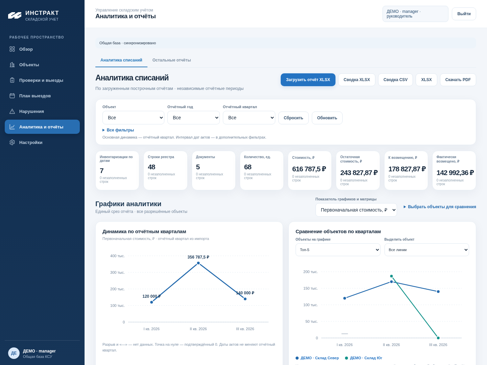
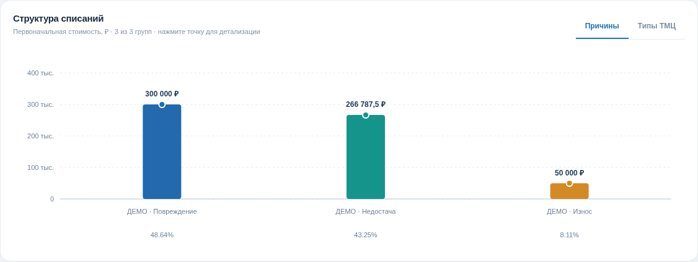
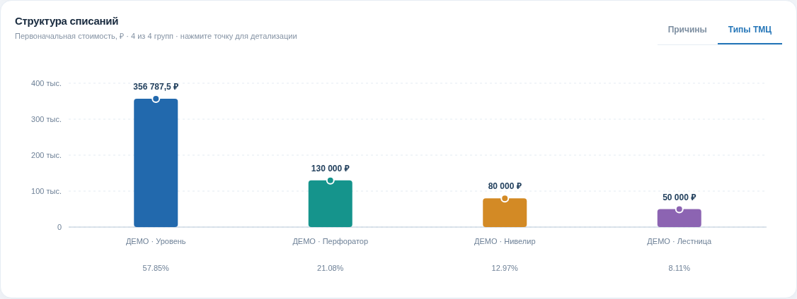
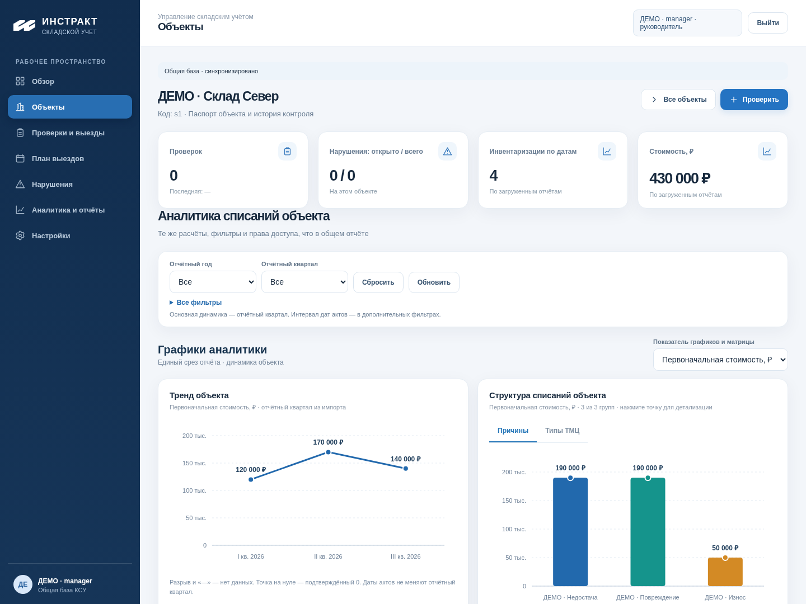
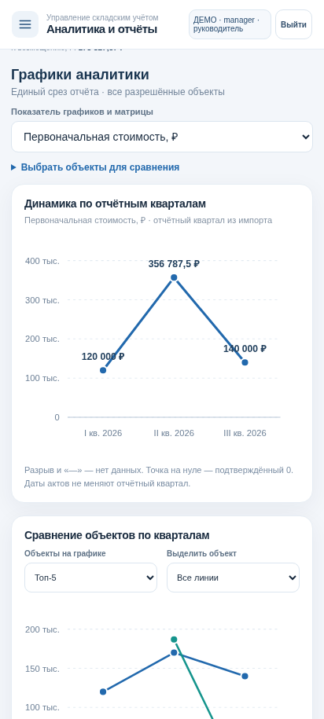
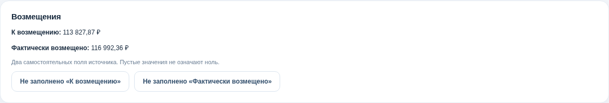

# PR46: графики для визуальной приёмки

Реальные экраны встроенного приложения на изолированной PostgreSQL 17. Загружены три **вымышленных построчных** отчёта Q1/Q2/Q3 2026. Это отдельные тестовые источники; файл-образец «Аналитика инвентаризаций» и данные владельца не используются. В рабочем приложении новые кварталы появляются только после загрузки их исходных отчётов.

## Верх дашборда

Графики находятся сразу после фильтров и KPI, перед матрицей/реестром. Показатель общий для графиков и матрицы. Сравнение поддерживает Топ-5/10/все, выбор линий и выделение объекта; точка или название открывает прежний паспорт.

## Причины и типы ТМЦ

Столбцы с подписями, значениями и долями. Наведение или фокус показывает русскую подсказку; клик на столбец/точку открывает отфильтрованный реестр. Общие фильтры применяются к данным, KPI и выгрузке; выбор линий/Топ-N влияет только на отображение сравнения.

## Прежний паспорт объекта

Краткий тренд и структура стоят после сводки объекта; ответственные, нарушения и проверки сохранены перед длинным аналитическим реестром. Показатели используют те же фильтры и ACL.

## Мобильная версия, ширина 412 px

Скриншот настоящего интерфейса в Chromium при мобильной ширине. Дополнительные фильтры/разрезы раскрываются по необходимости, вторичные счётчики компактны. Три квартала помещаются на оси тренда. У Юга нет Q1 — разрыв; Q3 загружен с нулём — точка на нуле. Это разные состояния.

## Возмещения после утверждённого уточнения

Два самостоятельных поля: «К возмещению» и «Фактически возмещено». Факт может быть больше, равен или меньше назначения; это допустимые исходные данные. Их разница и расчётные обязательства не отображаются. Пустое поле остаётся неизвестным, 0 — нулём. Реестр и CSV/XLSX содержат отдельные исходные колонки.

## Проверки и запуск

Автоматически проверены ось/разрывы/null/0, Топ-5/10/все, точная сортировка денежных строк до визуализации, экранирование, переключение показателя, квартальный/причинный drill-down, выгрузка того же среза, паспорт, мобильная ширина и права manager/inspector/viewer. Отдельная проверка списка объектов закрывает выдачу чужих названий и на SQLite; PG17 дополнительно применяет RLS. Конкурентные записи/импорт/экспорт остаются покрыты прежней целевой регрессией. Полная приёмка PR41 не повторяется.

Полные результаты, новые скриншоты и JSON появляются в артефакте **PR46-Charts** последнего успешного CI PR46; интерактивный проверенный комплект — **PR46-Preview**. [Короткий запуск Windows/Android](PR46_PREVIEW.md). Новая папка `PR46-Statement` и порт 8049 сохраняют предыдущий локальный стенд владельца.

Новых миграций и внешних библиотек нет. Amvera, main и рабочие БД не изменялись. PR остаётся Draft; merge/deploy возможны только после отдельного согласования владельцем.
