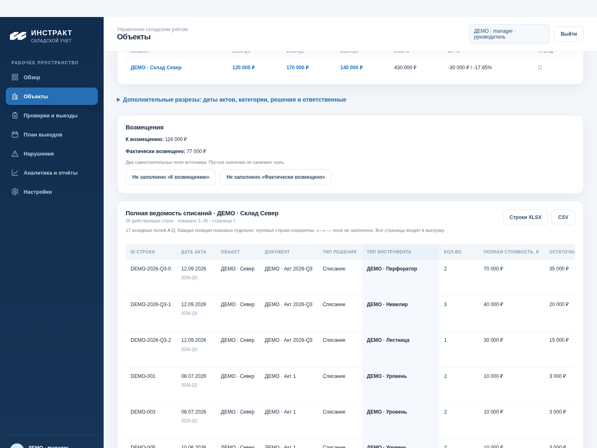
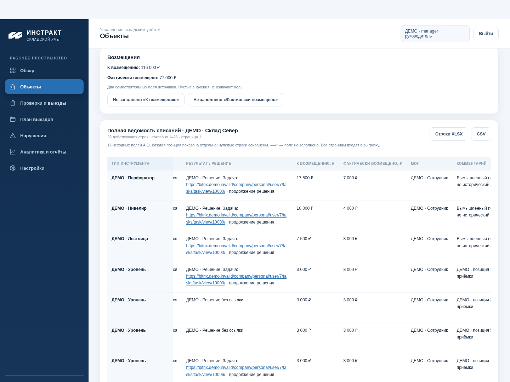
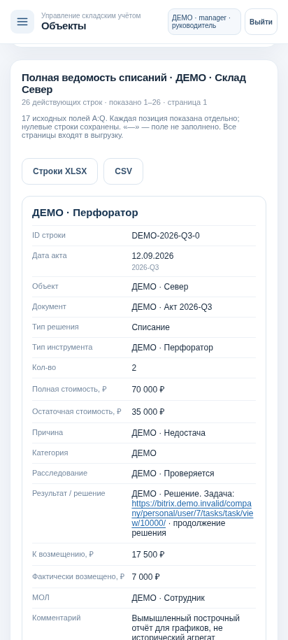

# PR46: полная ведомость списаний в паспорте объекта

Реальные скриншоты работающего приложения на изолированной PostgreSQL 17. Все позиции, сотрудники, суммы и адреса задач на этих экранах — **ДЕМО**. Источники владельца не включаются в Git/CI/комплект.

В прежнем паспорте сохранены графики, фильтры, история проверок и нарушений. Кнопка **«Полная ведомость»** сразу переводит к таблице. Каждая исходная позиция показана отдельно, без обязательного открытия карточки строки.

## Инструменты, количество и стоимость

Таблица содержит все исходные поля A:Q: ID, дата, объект, документ, тип решения, инструмент, количество, полная и остаточная стоимость, причина, категория, расследование, результат/решение, две самостоятельные суммы возмещений, МОЛ, комментарий. Пустота отличается от 0; нулевые и похожие строки не удаляются. Порядок — отчётный квартал, акт и строки источника.

## Решения и кликабельные задачи

Горизонтальная прокрутка открывает остальные колонки; тип инструмента остаётся закреплённым. Из поля **«Результат / решение»** кликабельными становятся только найденные HTTP(S)-адреса, без генерации ссылки по номеру. Текст до/после URL сохраняется. Переход открывается в новой вкладке без доступа к исходному окну и без Referer. HTML и неподдерживаемые протоколы остаются текстом, URL с учётными данными не активируются. Приложение не обращается к API Битрикс.

В предпросмотре `.invalid` — намеренно вымышленный домен. Автотест перехватывает только этот тестовый адрес и проверяет настоящий переход/отсутствие opener и Referer. Рабочий Битрикс не использовался. После импорта реального построчного отчёта отображаются его исходные URL.

## Телефон

В мобильной версии каждой позиции соответствует карточка со всеми 17 полями, включая решение, ссылку и комментарий. Ничего не спрятано за обязательной кнопкой «Открыть»; источник/версии доступны отдельно.

## Проверки и приёмка

Проверены 17 колонок/исходные комментарии, ссылки и обычный текст, 121 позиция на трёх страницах, нули/пустые значения, поиск, CSV, история версий, роли и безопасный переход в задачу. Графики и две независимые суммы возмещений сохранены. Все страницы входят в отфильтрованную выгрузку; на экране показаны диапазон/общее число строк.

1. Объект → «Полная ведомость»: сверить инструменты, количество, стоимость и причины с исходным отчётом выбранного объекта/периода.
2. Прокрутить к решению: текст и URL присутствуют; реальная задача открывается со своими правами Битрикс.
3. Проверить комментарии, нулевые строки, поиск и «Источник / версии»; выгрузить тот же срез.

[Запуск проверенного изолированного комплекта Windows/Android](PR46_PREVIEW.md). Для нового SHA используется новая локальная папка `PR46-Statement`, порт 8049; прежний стенд сохраняется. Новых миграций нет. Amvera, рабочие БД и main не менялись; PR остаётся Draft.
